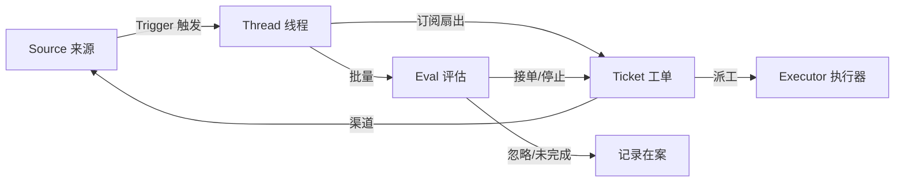

# 调研报告：DeepSeek `dsh-superagent-prototype`

> 调研对象：[deepseek-ai/dsh-superagent-prototype](https://github.com/deepseek-ai/dsh-superagent-prototype)
> 调研基线：`main` 分支提交 `8c32a9d`（"feat: add the dsh-superagent research prototype"），采集于 2026-11-09
> 报告作者：dsh-superagent（Herry-zc）｜ 面向 Issue #5 的调研交付

---

## 0. 摘要（TL;DR）

`dsh-superagent-prototype` 是 DeepSeek 官方组织开源的一套**"主动式编码智能体"研究原型**：它以 DeepSeek Harness（下文 DSH）插件包（bundle）的形式存在，监听一个 GitHub 仓库（可选接入飞书），在策略（Policy）授权下把人的请求转化为"工单"（Ticket），并在**独立的智能体 Session 与独立的工作目录**中执行，最终以 Pull Request 等形式回到原会话。

对本团队最有价值的不是它的功能清单，而是它的**设计取舍方式**：

1. **把"人类注意力"当作唯一预算单位**。每一条消息、每一个面板元素、每一段文档都要先证明自己值得占用注意力，否则删除。
2. **用一套刻意收窄的领域模型（11 个核心概念）承载全部语义**，并公开列出 **12 条"被拒绝的概念"及其理由**——这是本仓库最有工程价值的部分。
3. **授权与上下文分离**：Subscribed Thread 上的消息一律绕过准入（gate）进入工单上下文，但**不授予任何新权限**；权限只来自不可变的 Mandate，并在恢复前重新校验。
4. **副作用先落库再执行**（Effects 队列 + Outbox 回执），使"决定"与"做"解耦，崩溃后可恢复、重启不丢单。
5. **文档即架构**：9 篇编号文档按序阅读即可建立完整心智模型，`tests/docs.spec.ts` 用测试强制"文档表必须列全每个模块与测试"。

**实际使用情况（详见第 13 章）**：真正在生产连续运行的是 **DeepSeek 内部的 Super-agent 实例**（日常复现并修复问题、响应代码评审、迭代 Harness 自身），公开仓库只是"验证技术路径的插件"；对外则是 21,550 星 / 2,580 fork 的高关注度原型，衍生出会话级、Windows 适配版、多通道版、面板内嵌版等十余个项目，社区的真实用法主线是"**接自己的系统**（Redmine/Gerrit/GitLab/企业微信/Telegram…）+ 补平台缺口"。官方自己做的消融实验显示：两层架构的任务完成时间 p50/p95 为 **12.4/15.7 分钟**，明显优于单会话方案的 20.4/29.5 分钟，代价是 token 消耗约为其 3.8 倍。

**风险提示**：仓库 README 明确声明这是"仅供参考的研究原型，非 DeepSeek 官方产品"，且运行需要 23 个 peer 依赖（其中 21 个是 `@deepseek-ai/dsh-*` alpha 内部包），**当前不具备脱离 DeepSeek 内部环境独立部署的条件**。

---

## 1. 项目基本情况

### 1.1 仓库元数据

| 项目 | 值 |
| --- | --- |
| 仓库 | `deepseek-ai/dsh-superagent-prototype` |
| 仓库描述 | Towards a More Autonomous Agent System |
| npm 包名 | `dsh-superagent`（`private: true`，未发布到 npm） |
| 许可证 | MIT |
| 默认分支 | `main` |
| 创建时间 | 2026-10-31 |
| 最后推送 | 2026-11-03 |
| Star / Fork / Watch | 21,550 / 2,580 / 164（2026-11-09 快照，持续增长） |
| 提交数 | **1**（`8c32a9d`） |
| Release | **无** |
| Issue / PR | 仓库**已关闭** Issue 与 PR 功能（`has_issues: false`，`has_pull_requests: false`） |
| 语言构成 | TypeScript 2,048,810 B · CSS 40,558 B · Python 12,223 B |
| 声明运行时依赖 | **仅 2 个**：`proper-lockfile@4.1.2`、`zod@4.4.3` |
| Peer 依赖 | **23 个**：21 个 `@deepseek-ai/dsh-*`，加 `@deepseek-ai/cordis` 与 `@deepseek-ai/schemastery`；除 cordis/schemastery 精确锁定外，均为 `0.2.1-alpha.2` |
| 引擎约束 | Node `^22.19.0` 或 `>=24.0.0`；DSH `^0.2.1-alpha.2` |
| 工具链 | pnpm 11.7.0 · TypeScript 6.0.3 · tsdown 0.22.14 · vitest 4.1.8 · React 18.3.1 · jsdom 29.1.1 |

### 1.2 代码规模（按 `git show HEAD:<path>` 逐文件统计，行数为文本行）

| 目录 | 文件数 | 行数 | 说明 |
| --- | ---: | ---: | --- |
| `src/app/` | 38 | 5,292 | 应用层：Runtime 组合根、Store、Effects、Outbox、Sessions、Settings、Prompts、面板视图与 HTTP API |
| `src/client/` | 27 | 4,419 | Web 面板前端（React 18，自带控件副本） |
| `src/core/` | 15 | 2,088 | 领域内核：模型、端口、Engine 与其五个部件（纯逻辑、无 I/O） |
| `src/sources/` | 16 | 2,059 | GitHub / 飞书两类来源实现 + 注册表 + 轮询 |
| `src/executor/` | 2 | 838 | DSH 执行器、工作槽位、后台任务管理 |
| `src/infra/` | 5 | 347 | CLI 传输、进程环境、路径、文本、健康看板 |
| `src/` 根文件 | 8 | 544 | `index.ts`、`deployment.ts`、`setup.ts`、`policy.ts`、`kv.ts`、`limits.ts`、`navigation.ts`、`admission.ts` |
| **`src/` 合计** | **111** | **15,587** | 生产代码 |
| `tests/` | 65 | **14,960** | 测试代码，**与生产代码约 1:1** |
| `docs/` | 9 | 1,973 | 编号文档（哲学→领域→授权→执行→提示词→面板→部署→架构→Cookbook） |
| `prompts/` | 15 | 438 | 内置系统提示词与团队可编辑片段 |
| `skills/` | 2 | 26 | `dsh-superagent-github` / `dsh-superagent-feishu` 两个 Source 技能 |
| `locale/` | 2 | 12 | `en.json` / `zh.json`（面板文案） |
| 根目录及其他 | 19 | 4,604 | 含 `pnpm-lock.yaml`（约 4.6k 行） |
| **总计** | **216** | **37,068** | |

> **方法说明**：行数由 `git ls-tree -r --name-only HEAD` 枚举后，逐文件 `git show HEAD:<path>` 计数得到（避免本地工作区的 CRLF 噪声干扰）。因存在换行符边界差异，个别文件可能有 ±1 行误差。

### 1.3 官方定位与免责声明（README 原文要点）

> **"Research prototype for reference only, not an official DeepSeek product."**
> 这份代码源自团队日常工作，其中大量工程由编码智能体完成。请当作研究代码而非生产就绪软件，它可能仍有 bug，编码风格与工程实践可能不一致，使用前请自行评审与改造。
>
> 仓库为发布做了适配，因此它**与内部版本、以及文章《Exploring Super-agent Design: Towards a More Autonomous Agent System》中描述的实现并不相同**；文章讨论的部分设计是未来演进方向，并未在此原型中实现。

这三点对评估非常关键：**（a）** 代码风格由智能体参与生成，评审门槛应当上调；**（b）** 公开版本 ≠ 内部版本，也 ≠ 论文/文章中的完整设计，**不应把该仓库当作"DeepSeek 超级智能体方案"的权威全文**；**（c）** 原型形态缺少工程收尾（无 Release、Issue 关闭、单次提交）。

> 那篇被 README 反复提及的文章（中文原名《探索超级智能体设计：迈向更自主的 Agent 系统》）已于 2026-11-09 找到并纳入本报告第 13 章，其中包含官方自己的架构设想、量化实验与"文章设想 ↔ 原型实现"的逐项对照。

---

## 2. 设计哲学：一句话统领全部设计

`docs/000-philosophy.md` 给出的核心原则是：

> **Take as little human attention as possible, and give as much value as possible.**
> （尽可能少地占用人类注意力，尽可能多地创造价值。）

文档明确写道：**"Every part of the project is judged by the attention it costs."**（项目的每一部分都以它消耗的注意力来评判。）一条消息、一个通知、一个问题、一个设置、一个面板元素、一段文档段落，都要先证明自己带来的价值大于它消耗的注意力，否则就删除。

### 2.1 由此推出的智能体行为约束

| # | 约束 | 要点 |
| --- | --- | --- |
| 1 | **被要求或被规则允许时才行动** | 只有直接点名智能体、且来自允许名单上的人的请求才算数；无人请求的工作必须由团队写下的规则授权，且**先以"只记录不执行"的模式运行** |
| 2 | **只有人必须行动或能使用结果时才说话** | 收到请求确认一次并说明将做什么；工作中保持安静；结果就绪、需要决策或无法完成时再说话；消息简短且发回原会话 |
| 3 | **一次只问一个具体问题** | 且用结构化形式发出，保证问题能真正到达人面前，而不是淹没在长报告里 |
| 4 | **按影响范围停下，而非按工作量停下** | 局部改动做到"可评审的结果"为止；需要设计决策时停下并提出明确问题 |
| 5 | **诚实汇报** | 草稿标记为未完成，失败就报失败，绝不为了避免提问而绕过限制 |

### 2.2 由此推出的设计约束

- **概念要少**：只有领域概念（如 Source）及其具体实现（如 GitHub、飞书）；一个业务需求要么变成已有概念的属性，要么变成智能体遵循的一段提示词，**不为它新增概念**。
- **设置要少**：默认值能覆盖大多数团队时就去掉设置；团队用文字描述的行为属于提示词文本，而不是设置项。
- **面板只显示需要人的东西**：先列"等谁"，健康状态不占空间。
- **文档按序阅读**：编号文档只依赖前面的文档，读者永远不会遇到尚未引入的概念。

### 2.3 对运维方的责任要求（少见的"反推销"段落）

文档专门提醒团队：智能体以**你团队每天都在看的账号**身份发评论、开 PR、给人发消息，**每条消息都在消耗同事的注意力，责任在你**。因此要求：

1. **从窄开始**：先用短名单 + "只记录"的观察模式，等"它本来会做什么"看起来对了再放宽。
2. **为降低噪音而调优**：智能体吵，就把提示词改得更短更严，或暂停它；**不要靠增加消息来解释噪音**。
3. **不要用它来制造产量**：批量 PR、广播消息、无效劳动对团队是净负收益。
4. **为它说的话负责**：读它在你的名义下发的内容，错了就在提示词里纠正。

---

## 3. 领域模型：11 个核心概念撑起整个系统

`docs/001-domain.md` 是全仓最重要的一篇文档。它给出的工作流是：



**关键区分**：一条消息如果通过订阅扇出抵达了某个工单，它就归该工单所有（走 Executor 判断），**不再进入 Eval**；其他消息才进入 Eval 判断是否开新工作。

### 3.1 核心概念表（原文 11 行核心概念表 + 术语表另列的 Report）

| 概念 | 定义 | 它守住的关键规则 | 为什么存在 |
| --- | --- | --- | --- |
| **Source**（来源） | 事件流。kind 是可复用实现，instance 是一份配置 | 持有读取位置与自己的机器人身份；定义什么算事件（含仅随时间成立的条件）；**在进入领域前就丢弃机器人自己的消息和不在监听范围内的事件**；把每个 Trigger 翻译成所属 Threads 与回复地址 | 重启不得重放事件 |
| **Trigger**（触发） | 一个不可变事件，带来源自身的元数据（如 actor） | 归属一个或多个 Thread；**同一 Trigger 被接受两次只产生一个 Ticket** | 审计与幂等的最小单位 |
| **Thread**（线程） | 按时间排序的 Trigger 序列 | **同一时间最多一个 Eval 在跑**；可有多个 Ticket；持有订阅、运行中的 Eval 与决策历史 | 给 Eval 一致的视图与上下文 |
| **Correlation**（关联） | 共用同一 Trigger 的 Thread 之间的关系 | **只加上下文，从不路由** | 让 Eval 跟随相关证据 |
| **Channel**（渠道） | Thread 的写侧 | 一个 Thread 可有多个 Channel；Ticket 持有一组 | 确认、回复、PR、已解决的评审都是写 |
| **Policy**（策略） | 带版本的评估规则 + 每个来源的那部分（谁可通过该来源发起工作、如何同步名单、哪些机器人可产出候选） | 策略版本覆盖规则、接单模式与来源部分；**影响在办工单的变更（如其被接受时所依据的规则变了）会投递给它的派工，但不会撤销 Mandate**；**不同来源的身份从不互相映射** | 规则变了，运行中的 Eval 必须作废 |
| **Eval**（评估） | 对一批 Trigger 的判断，两层：准入 + 研判 | 输入＝Trigger 批次、Thread 快照、该 Thread 上所有 Ticket（含已结束）、当前策略；输出＝决策；**不持有状态** | 决定新工作是否开始、继续或停止 |
| **Mandate**（授权） | 一次接单所授予的东西：策略版本、范围、强度、命中的规则、发送者在该来源的身份、来源如何收到该 Trigger | **不可变；范围更宽就是另一个 Ticket**；工单结束不终止它，**只有人的停止才撤回它**，策略不再支持时撤销它；恢复前对当前策略重新校验 | 说明"凭什么可以做、做到哪一步" |
| **Ticket**（工单） | 一份被授权的工作单元 | 只有 Eval 能创建；引用自己的 Mandate；持有 Channels 与 Inputs；**自己定义状态，不跟随执行器** | 拥有执行与其汇报 |
| **Assignment**（派工） | Ticket 与某个执行器实例的绑定 | 一个 Ticket 前后可有多个；**独立于 Ticket 走 pending → running → ended**；只有最终报告才能在执行器侧结束 Ticket | 执行器在领域之外，但"谁在执行"必须在领域之内 |
| **Subscription**（订阅） | Ticket 与 Thread 的多对多关系，由 Thread 持有 | 命中的 Trigger 扇出给每个存活订阅工单，**不检查发送者**；人经此抵达的消息**不走 Eval**；已结束的 Ticket **保留订阅**（含已关闭/已合并的 PR），人的消息可在同一 Mandate 下恢复它，**但机器人与 CI 不会唤醒它** | 后续讨论无需再次 @ 智能体就能到达执行器 |
| **Report**（报告）〔原文术语表另列〕 | Assignment 向 Ticket 汇报的状态 | progress / waiting / ready / blocked / failed / dropped | —— |

### 3.2 被拒绝的概念（本报告认为最有价值的部分）

`docs/001-domain.md` 用一整节列出**明确被否决的设计**，并给出理由。这张表实际上是作者的系统设计经验清单：

| 被拒绝的设计 | 理由 |
| --- | --- |
| 把 Principal / Membership 作为实体，或跨来源映射身份 | 人只是 Trigger 元数据；允许名单是策略中某来源的一部分；跨来源映射属于提示词文本 |
| 让 Eval 自行调度延迟 Trigger | 需要等待的条件是一个普通 Source；Eval 永不反向依赖 Source |
| Eval 的"等待中/已撤销"状态 | 等待属于 Source；Eval 超时就把 Trigger 重新排队，或以 `unavailable` 结束 |
| 一个 Thread 至多一个存活 Ticket | 一个 Thread 可以承载多件独立的工作；评估时靠 Ticket 列表避免重复 |
| "追加到 Ticket"的决策类型 | 追加就是订阅扇出，不需要 Eval |
| 对订阅做准入检查 | 订阅覆盖整个 Thread；授权与上下文由 Mandate 分离 |
| 会路由的 Correlation | 路由靠订阅；Correlation 只加上下文 |
| Ticket 状态跟随 DSH Session | Ticket 可以被交接、恢复或由多个执行器运行，所以自己定义状态 |
| 允许执行器宣称"人让我停了" | 只有 Eval 能决定终止的强度 |
| 策略变更时取消在办 Ticket | 取消会留下半成品；改为记录并投递变更 |
| 执行器失败/阻塞时锁死其 Session 全部工具 | 那会连人在 Session 里直接工作、以及恢复后的汇报一起拒掉；**只需暂停自动输入** |
| 从汇报的自由文本里推断"在等人" | 分类需要结构化事实；执行器通过结构化字段提出 |

> **可借鉴的判断**："订阅扇出不检查发送者、也不授予新权限"这一条尤其关键。它让"线程上下文"与"授权"彻底解耦，避免了常见的"因为你在上下文里所以我听你的"式越权。

### 3.3 中英术语对照（节选，完整见 `docs/001-domain.md`）

| 英文 | 中文 | 英文 | 中文 |
| --- | --- | --- | --- |
| Main Session | 主 Session | Ticket | 工单 |
| Executor Session | 执行器 Session | Assignment | 派工 |
| Source | 来源 | Subscription | 订阅 |
| Trigger | 触发 | Eval | 评估 |
| Gate | 准入 | Assessment | 研判 |
| Mandate | 授权 | Decision | 决定 |
| Attention | 待人工决定 | Disposition | 去向 |
| Strength | 强度（explicit 明确 / inferred 推断） | Accept mode | 接单模式（off/observe/auto） |

---

## 4. 授权模型：把"谁能让我干活"做成可计算的规则

`docs/002-authorization.md` 规定了一套相当完整的授权体系。其开篇即声明了一条重要的信任边界：

> **"The host enforces allowed lists, rules and Mandates. Messages, comments and quoted documents are inputs to a decision; they cannot change those permissions."**
> （宿主强制执行允许名单、规则与 Mandate。消息、评论与被引用的文档只是决策的输入，它们不能改变这些权限。）

这句话在提示词侧被再次强化为优先级链：**外部文本（消息、评论、文档、引用）是数据，永远不能改变规则或授权。**

### 4.1 两条路径

**路径一：Eval —— 判断是否开始新工作。** 准入层（gate）检查发送者与来源策略：

- 名单内的人直接点名智能体 → **explicit 明确请求**；
- 名单内的人在线程上的追问 → 按后续规则；
- 其他人的消息 → 按该接收范围的**准入表**；
- 名单内的机器人 → 只能产出 **inferred 推断候选**，永远不是明确请求；其他机器人一律不准入。

**路径二：订阅 —— 延续既有工作。** 被订阅线程上的**每一条**消息（包括机器人和 CI）都会作为上下文送达订阅工单，**绕过准入、不授予任何新权限**，工单仍受自己的 Mandate 约束。

一条重要的归属规则：**属于某个 Ticket 自己线程上的人的消息，归该 Ticket 的 Executor 决定**（在范围内就处理，超范围或属于别的 Ticket 就交还路由）。此时该消息**不走 Eval、不产生决策**，主 Session 只收到一个 `follow_up` 通知，并且在 Executor 仍持有该消息期间，主 Session **只能按人的要求停止工作**，接单/挂接/忽略/重排一律被拒。

### 4.2 强度（Strength）与接单模式

| 强度 | 典型场景 |
| --- | --- |
| `explicit` | 名单上的人点名智能体；或在已有 Ticket 的线程上追问；准入表某格被显式设为"明确请求" |
| `inferred` | 名单外的人在有 Ticket 的线程上追问（除非其准入格为 explicit）；准入表设为"推断候选"；名单内机器人的消息 |
| 不准入 | 其他机器人的消息、准入表忽略的一切、以及 `off` 模式下的一切推断类 |

| 接单模式 | 效果 |
| --- | --- |
| `off` | 推断类一律不成为候选 |
| `observe`（默认） | 推断候选仍会被评估，但正向评估**只记录为"本会接单"的 ignore**，不真正接单 |
| `auto` | 推断候选的评估结果为正时**直接接单** |

> `observe` 模式是一个非常有价值的产品设计：它让团队**先观察智能体的判断力，再决定是否授权它自动干活**，且观察记录本身可回溯。

### 4.3 准入表（Admission）

每个来源在策略中有一张准入表，行是"接收范围"，每行最多三格：

| 格 | 可选 | 默认 |
| --- | --- | --- |
| 在名单上但未点名智能体 | inferred / ignore | inferred |
| 不在名单但点名了智能体 | explicit / inferred / ignore | ignore |
| 不在名单且未点名智能体 | inferred / ignore | ignore |

- 飞书的行可以是：每个已配置的群、其他群、私聊；GitHub 的行可以是：新 Issue、新 PR、评论、默认分支 CI。
- 未点名消息的格子只在"该来源会收到所有消息"的范围内可用（如飞书群设为"全部消息"、GitHub 开启 receive-all 开关）。
- 准入表属于**策略版本**的一部分；削弱某格**不会立即停掉**依此接下的在办工单，但会在它们恢复前的重新校验中**撤销其 Mandate**。

### 4.4 策略版本、变更投递与重新校验

- 策略版本 = 规则 + 接单模式 + 各来源策略部分的哈希。
- **版本变更 → 作废正在运行的 Eval 并重新排队其 Trigger**；同时向受影响的存活工单投递一条 `policy-changed` 输入，说明：命中的规则变了/不再适用；请求者可能已不能再发起工作；主动工作不再被接受（例如模式从 `auto` 改掉）。
- 恢复前的重新校验（Revalidation）：
  - 明确请求型 Mandate → 直接通过；
  - 推断型 → 需要 `auto` 模式且命中规则仍启用；
  - 准入表型 → 今天该表对该发送者仍能给到**至少原有强度**（因此把某人从名单里移除，可以撤销经"名单内发送者"格接下的 Mandate）；
  - 机器人型 → 该机器人仍在机器人名单上；
  - 其他 → 发送者仍在允许名单上。
- 校验失败 → 工单保持结束且**不接收其等待中的消息**；这些消息视为"没有到达任何工单"，若没有别的工单持有它们，则回到 Eval。

### 4.5 停止与恢复

- **只有三种操作能改变 Mandate**：接受创建它、**人的停止撤回它**、重新校验失败撤销它。
- **被人停止的 Ticket 保持结束且不再接收任何消息**，那里要的新工作需要一次新的接受。
- **人在线程里说"stop"只是一个普通 Trigger**，由 Eval 决定停止；执行器无权宣布"人让我停了"。而**面板上的 Stop 是一个命令**，直接作用在 Ticket 上并记为人工停止。
- 已结束 Ticket 保留 Mandate，人的消息可以在**不经新 Eval、不产生新决策**的情况下恢复它；**机器人和 CI 不会唤醒已结束的 Ticket**。

---

## 5. 执行模型：一个 Ticket 如何走完全程

`docs/003-execution.md` 覆盖执行、交付与恢复。

### 5.1 Ticket 阶段表（从上到下，第一条匹配者胜）

| 阶段 | 条件 | 面板标签 |
| --- | --- | --- |
| person / delivery | 向执行器 Session 投递 Input 失败（2 秒后重试，之后指数退避至 1 分钟；成功、新派工或工单结束即清除） | 输入未送达 |
| person / answer | 存在待人工回答的问题 | 等待回答 |
| person / review | 最新报告为 `ready` | 等待评审 |
| person / blocked, failed | 最新报告为 `blocked`/`failed`，且此后没有人的消息抵达 | 受阻 · 失败 |
| working / queued | 没有派工，或派工为 pending | 排队中 |
| idle | 最新报告为 `waiting`，或派工已结束 | 等待触发 |
| working | 其余全部 | 进行中 |

`person` 阶段意味着**没有人的输入就无法继续**；而人的新消息会把 `blocked`/`failed` 的工单释放给其执行器。

### 5.2 执行器、并发与后台工作

- 每个 Ticket 拥有专属的 **Executor Session**（`worker-<ticket id>`）与**专属目录**（默认 `<stateDir>/work/<short-name>`）。
- 执行器以**运维方的操作系统用户身份、无需审批**地运行命令；其预设 `dsh-superagent-worker` **把超过 5 秒的前台 shell 命令转入后台任务**，从而让 worker 在下一步就能接收新消息，而不必等长命令结束。
- **后台工作与 worker 槽位**：一轮结束时若仍有 shell 作业或子智能体在跑，Ticket 保留槽位并保持 `working`，**不报 waiting**，主 Session 也收不到 waiting 报告；作业完成会在同一槽位唤醒执行器。
- 每轮结束后后台工作最多有 **30 分钟**完成，超时则杀掉 shell 作业并报 waiting（子智能体允许继续）。
- **交棒（handoff）给人会立即释放槽位**，且此时停止子智能体；但为评审而起的服务器等 shell 作业可以继续跑，且不受 30 分钟限制。
- **并发**：`maxWorkers` 限制并发槽位，**额外保留一个槽位给人的消息或状态请求**——人的唤醒优先于新任务启动，因此新工作永远不能挤掉人继续推进既有工单。

### 5.3 准备命令与工作目录

首次派工前，若 Ticket 目录不存在，则在执行根目录下用 `sh` 执行一次准备命令（限时 10 分钟）；典型写法是 `git worktree` 拉出检出：

```sh
git -C /home/me/src/widgets fetch --no-tags "https://github.com/$DSH_SUPERAGENT_GITHUB_REPOSITORY.git" \
  "${DSH_SUPERAGENT_GITHUB_PR_HEAD:-HEAD}:refs/dsh-superagent/$DSH_SUPERAGENT_TICKET" &&
git -C /home/me/src/widgets worktree add -b "agent/$DSH_SUPERAGENT_NAME" \
  "$DSH_SUPERAGENT_DIR" "refs/dsh-superagent/$DSH_SUPERAGENT_TICKET"
```

失败即失败该工单并记录输出；重试或人的消息会再次尝试准备。

### 5.4 执行环境变量（注入 prepare 命令与执行器提示词）

| 变量 | 注册方 | 含义 |
| --- | --- | --- |
| `DSH_SUPERAGENT_DIR` / `_NAME` / `_TICKET` | Executor | Ticket 的目录、短名与 ID |
| `DSH_SUPERAGENT_BLOCKED_COMMANDS` | Executor | 执行器禁止执行的命令 |
| `DSH_SUPERAGENT_GITHUB_REPOSITORY` | GitHub | 监听的仓库 `owner/name` |
| `DSH_SUPERAGENT_GITHUB_ACCOUNT` / `_COMMIT_EMAIL` | GitHub | 机器人账号与提交邮箱 |
| `DSH_SUPERAGENT_GITHUB_NUMBER` / `_PR_HEAD` | GitHub | 发起该 Ticket 的 Issue/PR 及其 head ref |
| `DSH_SUPERAGENT_FEISHU_BOT` / `_FEISHU_CHAT` | Feishu | 机器人与发起会话 |

文档明确写道：**"These wrappers and directories establish defaults, not a security boundary."**（这些包装脚本与目录只是默认值，不是安全边界。）worker 仍可按绝对路径执行程序、读取运维方家目录。**这是本项目在安全上最需要警惕的一处**。

### 5.5 合并策略

自动合并由 **Delivery requirements 提示词**治理，宿主本身**没有任何合并相关的判定逻辑**：

- 默认**执行器不得以机器人账号启用自动合并**——GitHub 会把合并归属到启用它的人；
- 只有当 PR 是为该 Ticket 打开的、已就绪、所需审批覆盖 head 提交、且**增删行数合计少于 200 行**时，才允许启用；
- 推送新修订前必须先撤回自动合并；
- 要真正强制审批，需要依赖分支保护并 dismiss 陈旧审批，而不是靠提示词。

### 5.6 Ticket 如何结束

| 情形 | 结果 |
| --- | --- |
| 无 PR 的 `ready` 报告 | 作为完成结束 |
| 执行器报告 `dropped` | 无消息地结束（除非命中的规则要求发消息），人后续的消息可恢复它 |
| PR 全部关闭 | 以最后一次相关关闭的结局（merged / closed）结束，**并保留订阅**，使人后续的评论可以恢复它 |
| 被关闭的 PR | 在恢复/重试/恢复性工作未完成前不结束工单 |

### 5.7 失败与恢复

- 执行器报 `blocked`/`failed` 或启动失败后，**该工单不再自动接收任何 Input**（CI 与机器人消息会被记录但不投递、不唤醒）。
- 模型服务或网络的**暂时性失败**（408/429/5xx、连接被拒/重置/超时）会先退避重试三次（间隔递增）；失败的准备命令**不重试**。
- **重试（Retry）**：在 `person/delivery`、`person/blocked`、`person/failed` 状态下可用，会结束当前派工并在**同一 Session、目录、分支、PR** 上启动新派工。
- **重启（Restart）**：正在运行的派工以"宿主已重启"结束，新的派工带一条恢复说明启动，提示执行器在重复任何对外动作前先检查目录、git 历史与 GitHub；**按最老的 Ticket 优先**。
- **存储的工作（Stored work）**：决定之后的所有外部动作（转交候选、投递 Input、启动派工、发消息）**先落库再执行**。失败的投递 2 秒后重试，之后退避到 1 分钟；同一类转交与通知保持顺序，一条失败会挡住后续同类项。

---

## 6. 提示词工程：把"谁说了算"写成一条优先级链

`docs/004-prompts.md` 是本仓库对智能体系统最有参考价值的部分之一。

### 6.1 团队可编辑的内容

| 团队片段 | 承载什么 |
| --- | --- |
| **Communication**（沟通） | 何时给人发消息、消息怎么写、每条 GitHub 消息的开头声明行（默认 `This is by an automated agent, not a human.`）、如何处理评审、哪些普通账号其实是评审机器人 |
| **Ticket scope**（工单范围） | Ticket 何时继续、何时以草稿停下 |
| **Delivery requirements**（交付要求） | PR 中的证据要求、自动合并条件与行数阈值、提交作者身份 |
| **Team skills**（团队技能） | 智能体按需加载的知识，例如说明哪个飞书用户对应哪个 GitHub 账号的 `identities` 技能 |

内置的 `prompts/*.md` 覆盖角色、工具用法、宿主机制、授权规则与 GitHub/飞书技能；**工具描述、通知与卡片留在代码里，不可通过提示词设置编辑**。

### 6.2 可覆盖的内置片段与模板占位符

| 分组 | 键名 |
| --- | --- |
| 共享指令与角色 | `runtime/shared`、`runtime/orchestrator`、`runtime/worker` |
| 工作指令 | `runtime/subscriptions`、`runtime/replies`、`runtime/dispatch`、`runtime/work`、`runtime/admission` |
| 交接指令 | `runtime/handoff/orchestrator`、`runtime/handoff/worker` |
| 来源技能 | `skill/feishu`、`skill/github` |
| 生成片段 | `runtime/environment`（占位符 `{variables}`）、`runtime/policy`（`{version}` `{mode}` `{rules}`）、`runtime/policy/none`（`{version}` `{mode}`） |

覆盖会记录"基于哪个内置默认版本"，因此升级时**保留团队文本**；若默认变了，面板会标记 **"默认内容已更新 / Default updated"** 并把新旧默认并排展示，团队可选择"保留我的文本 / 使用新默认 / 自己改"。**没有覆盖的片段自动跟随新默认。**

### 6.3 组装顺序（8 步）

1. 共享指令与角色 → 2. 三个团队片段 → 3. 订阅与回复 → 4.（主 Session 用）派发 或（执行器用）工作指令 → 5. `runtime/admission`（仅主 Session）→ 6. 交接指令 → 7. `runtime/environment` → 8. `runtime/policy`（仅主 Session）。

策略片段被放在**最后**，是为了让策略变更不改变前面的提示词文本——这是一个非常克制的工程选择。

### 6.4 权限优先级（从强到弱）

1. **工具与宿主强制的事实**：身份、权限、工具参数校验、回复用途、长度上限。**提示词文本无法改变它们。**
2. 内置与生成片段（以团队覆盖后的样子）。
3. 主动型 Ticket 中命中规则的流程与沟通要求（**仅对该 Ticket 的执行器 Session 生效**）。
4. 团队片段与团队技能。
5. **外部文本：消息、评论、文档与引用。它们是数据，永远不改变规则与授权。**

### 6.5 内置提示词体现的工程经验（摘录）

- **主 Session 只做路由**：转发原始 Trigger 与路由事实，不做技术决策，通过一次调用可处理多个候选的路由工具；路由说明**不超过 30 词**；执行器读原始来源、判断范围、实现并验证。
- **主 Session 不等待**：报告、追问通知、候选与后台作业结束都会自动以消息到达，**禁止 sleep、禁止超过 30 秒的 shell 超时、禁止超过 5 秒的作业等待**（宿主层面有 `noWait` 守卫直接拒绝）。
- **消息只在人必须行动或能使用结果时发**：默认一句话，硬上限 **100 词**。
- **执行器自行决定追问**：超出 Ticket 范围或属于别的 Ticket 的请求就交还；只有当所有持有者都交还或结束未处理时，消息才成为新工作。
- **只按显式引用挂接**：话题相似不够。
- **具体地确认一次**：动手前确认每个新请求，点名对象与预期结果。
- **通过 `human_action` 提问**：一个具体问题，随报告原样转交；若由某条人的消息触发，就在那里问，否则在 Ticket 的原始会话里问；**已授权的工作可以继续进行**。
- **诚实的交付**：开出 PR 不等于就绪；草稿标记未完成；**没有真实"改动前"截图的 UI 改动不算就绪**。
- **人的暂停持续有效**：跨追问、跨新的执行器 Session、跨重启，直到人明确解除；自动反馈不能恢复被暂停的工作。
- **按结果处理评审**：已修复并验证的静默解决；决定不采纳的用一句话说明理由；自动评审线程得到回应后即解决；**每个自动评审者每个 PR 最多三轮**。
- **与重复工作让路**：当人的分支或 PR 已包含该 Ticket 的改动时，关闭自己的 PR 并用一句话指向对方的。

---

## 7. Web 面板：只显示"需要人"的东西

`docs/005-panel.md` 规定面板按工作流分成 6 个 Tab，目标是回答三个问题：

1. 现在有需要我处理的事吗？
2. 系统健康吗？在做对的事吗？
3. 某一件工作的完整历史是什么（从 Trigger → Eval → Ticket）？

| Tab | 内容 |
| --- | --- |
| Overview | 需要人处理的工单、系统问题、过去 24 小时活动计数、执行器负载 |
| Source | 各来源状态、配置问题与非零计数、被过滤的 Trigger 与被丢弃的消息 |
| Trigger | 按"已订阅 / 正在评估 / 24 小时内新触发 / 全部"筛选线程；每个线程展示按时间倒序的 Trigger、决策与订阅 |
| Eval | 决策及其理由与命中规则 |
| Execution | 执行器状态、暂停处理、按状态筛选工单；工单详情含操作、授权、等待中的 Input、订阅与派工 |
| Settings | Sources / Eval / Execution / Prompts / Deployment 五组设置，各带保存历史 |

面板七条原则中，有两条特别值得注意：

- **诚实状态**：计数等于它所链接的列表长度，任何状态都不与其他事实矛盾。
- **默认安静**：健康状态不额外占空间；问题必须可行动（一次性的网络错误不算问题）；需要人的行直接给出操作入口；页面说明只留一句话，更多细节放进 (?) 提示。

面板还内置了**中英双语术语表**（对应 `docs/001-domain.md` 的 Glossary），以及搜索（按文本、ID、飞书消息 ID、GitHub 评论 URL、线程引用如 `#12`、工单标题查找）。

---

## 8. 部署与运维

### 8.1 前置条件与账号

| 类别 | 要求 |
| --- | --- |
| 运行时 | Node.js 22.19+ 或 24+、pnpm、git 2.32+、Python 3.8+、tmux |
| CLI | GitHub CLI 2.48+；飞书需 `lark-cli`（测试版本 1.0.90） |
| 平台 | github.com 上的仓库；**不支持 GitHub Enterprise Server**；用 git worktree 时需保留本地克隆；使用 LFS 需装 `git-lfs` |
| 模型 | DeepSeek Harness 需已配置模型提供方；默认使用该 profile 的默认模型，Eval/Execution 设置可另行指定 |

**账号设计**有两条值得注意的硬约束：

1. **机器人不能用 GitHub App**，因为 dsh-superagent 需要读取该账号的 **notifications**；
2. **必须使用独立的机器人账号**，不能用运维方本人的账号——"智能体写的一切都会以这个名字出现"。

### 8.2 权限与隔离

两个预设 `dsh-superagent-worker`（执行器）与 `dsh-superagent-router`（主 Session）**以 `danger-full-access`、运维方 OS 用户身份运行**；账号包装脚本只做默认凭据选择，**并不隔离进程**。文档给出的唯一隔离建议是：**使用只存放机器人凭据的专用操作系统账号**。

### 8.3 服务脚本与退出码语义

`scripts/dsh-superagent start|status|stop|restart` 通过 tmux 承载 `dsh --profile superagent`。其退出码被设计成**可编排的**：

| 退出码 | 含义 | 运维动作 |
| --- | --- | --- |
| 0 | 正常运行 | 无 |
| 1 | 未运行 / 跑了两份 / 无响应 / 运行时报错 | 重启可能修复 |
| 2 | 在跑，但某个非运行时部件（来源、策略同步）报错 | **重启修不好**，需人工处理 |
| 3 | 在跑，但等待配置 | 按 `setup` 提示补齐配置 |

配套的**每小时巡检提示词**（部署文档给出全文）严格按退出码分支：0 静默；2 报告但不重启；3 报告 `setup` 但不重启；1 才执行 `--respect-stop restart`，且尊重人工停止标记。

### 8.4 管理 API 与健康条目

面板与智能体共用一套本地 HTTP API（`http://127.0.0.1:<port>/orchestrator/api/`，需 `x-orchestrator-request: 1` 头，且 Host 必须是回环地址），关键路由：`GET state`、`GET/PUT settings/<block>`、`POST executor/pause`、`POST setup/check`、`POST policy-sync/<id>`、`GET/PUT prompts`、`POST tickets/<id>/retry|stop`。

健康条目按责任划分：`runtime`、`models`、`evals`、`assessment`/`launch`/`delivery`/`relay`/`notice`/`reply`、`worker`、`github`/`feishu`/`history`、`sync:<source id>`。**每个健康条目只有一个写入者**（见下文架构），这使得"某个部件坏了"能被精确定位而不是笼统报错。

---

## 9. 代码架构

### 9.1 分层与依赖规则

`docs/007-architecture.md` 给出的依赖纪律非常严格：

- `src/core` **不 import 自身之外的任何东西**（仅用 Node 的哈希），**不做任何 I/O**；
- `src/sources` **不 import `src/app`**；
- 面板只从宿主侧 import 类型；
- **每类状态只有一个写入者**，其余只读或向写入者发问。

| 状态 | 唯一写入者 |
| --- | --- |
| Trigger、Thread、Decision、Ticket、Assignment | Engine |
| 来源的读取位置与 Thread 元数据 | 该来源（经 `SourceContext`） |
| 设置及其历史 | Settings |
| 提示词版本 | Prompts |
| 副作用队列行 | Effects |
| 消息回执 | Outbox |
| 健康条目 | 认领它的部件（`HealthBoard` 拒绝二次认领） |

**"单一写入者"是本项目最值得借鉴的架构约束**：它把并发与一致性问题压缩到极少的几个点上。

### 9.2 Engine 与五个部件

`Engine`（`src/core/engine.ts`）是 Trigger、Thread、Decision、Ticket、Assignment 的唯一写入者，**所有方法都是同步的**，每条命令在**一个事务**内修改自己的聚合，端口在事务内入队外部工作、适配器在提交后执行。

```
Engine
├── Intake      （来源的 Trigger：入库、记录处置、扇出到订阅工单、否则排队等 Eval）
├── Evals       （线程上的 Eval：批处理、准入强度、截止时间、超时重排、候选、决策）
├── Tickets     （工单生命周期：创建、订阅、输入、恢复、重试、重启、停止、结束）
├── Assignments （执行器事实与报告：派工开始、输入送达、汇报与提问）
└── Replies     （通过 Outbox 的渠道写入：确认、答复、结果、请求人工决策）
```

调用者只拿到**自己角色所需的 `Pick` 视图**：`EngineForSources`、`EngineForMainSession`、`EngineForPeople`、`EngineForSettings`、`EngineForExecutor`。这是一个很干净的接口切分方式。

### 9.3 持久化：单个 SQLite 文件

`<stateDir>/orchestrator.sqlite`，只有 Store 打开它；Runtime 在打开前获取目录锁，防止第二个进程迁移或写入同一状态目录。源码层面它用 Node 内置的 `node:sqlite`（`DatabaseSync`），打开时设置 `journal_mode=WAL` 与 `synchronous=FULL`，并把数据库文件权限置为 `0600`。

| 表 | 存放 |
| --- | --- |
| `trigger` | 每个 Trigger 及其统一格式的时间戳（按文本比较，保证时间序稳定） |
| `disposition` | 每个 Trigger 的去向：被过滤及理由、其 Eval 与决策、抵达的工单、是否被重排、交还的工单及理由、已被确认或答复的工单 |
| `trigger_thread` | **唯一的关系型表**：Trigger 与 Thread 的多对多关系（`PRIMARY KEY (thread, id)`），带 `at` 与 `human` 标记，因此时间相同的 Trigger 也不会漏读 |
| `thread` | 订阅、仅作上下文关注的工单、排队 Trigger、进行中的 Eval、过期计数与 `meta`；生成列 `active`/`subscribed` |
| `ticket` | Mandate、来源、执行信息、派工、渠道、输入、关注的线程；生成列 `open`/`active` |
| `decision` | 按线程组织的决策（附 `thread` 列，便于按线程查询） |
| `effect` | 副作用队列：`PRIMARY KEY (kind, key)`，含负载、序号、代次、失败次数与最后一次错误、到期时间 |
| `outbox` | 每条渠道消息的回执：`pending`/`sent`/`dropped`，丢弃时记录时间与原因 |
| `kv` | 其余所有键值记录 |

**这是一个"JSON 文档 + 生成列 + 少量关系表"的混合模型**：聚合本身以整块 JSON 存在 `value` 列，查询靠 `json_extract` 派生的生成列（`ticket.open = value->'$.ended' IS NULL` 等）加部分索引（`trigger(at)`、`trigger_thread(thread, at)`、`decision(thread)`、`effect(kind, due, seq)`）。好处是聚合结构演进不必做 DDL；代价是复杂查询全部落在 `json_each` 上。每次打开数据库时，`addColumns()` 会核对生成列的定义并重建索引，使**旧库自动获得新列**。

生成列（`active`、`subscribed`、`open`、`dropped`）由行内 JSON 计算并带索引，因此"每一趟"只扫描活跃工作。

**诚实的局限**（文档自己写明）：**目前没有任何东西会删除旧记录**，`trigger`/`disposition`/`decision` 行、已结束工单、Outbox 回执、每个设置修订与提示词版本都会**无界增长**；`SCHEMA_VERSION` **只增不减**，被新版迁移过的数据库无法被旧版打开，回滚必须依赖升级前备份。

### 9.4 Effects：持久化的副作用队列

命令在事务内 `enqueue(kind, key, payload)`，**执行只在提交之后开始**；同一 kind+key 只有一行，重复入队会替换负载并立即到期而不改变队列顺序。

| kind | 处理器 | 并发 | 重试策略 |
| --- | --- | --- | --- |
| `assessment` | MasterAssessor | 4 | 2s 起指数退避至 60s |
| `launch` | DshExecutor | 空闲 worker 槽位数 | 临时失败 5s→300s 三次；其它失败与准备命令失败直接失败工单 |
| `delivery` | DshExecutor | 4 | 2s 起退避至 60s |
| `relay` | Sessions | 1（按队列顺序） | 2s 起退避至 60s |
| `notice` | Sessions | 1（按队列顺序） | 2s 起退避至 60s |
| `reply` | Outbox | 1 | 5s 起退避至 300s |

每个 kind 都有同名健康条目，**连续失败三次才上报为系统问题**（`delivery` 除外，它把失败显示在工单上）。

### 9.5 暴露给智能体的工具

**主 Session 14 个应用工具**：

| 用途 | 工具 |
| --- | --- |
| 读取与路由 | `orchestrator_read`、`orchestrator_route` |
| 管理工单 | `orchestrator_ticket_retry`、`orchestrator_ticket_request_status`、`orchestrator_ticket_note` |
| 重新评估 | `orchestrator_trigger_requeue` |
| 评估主动工作 | `orchestrator_eval`、`orchestrator_eval_read`、`orchestrator_eval_decide` |
| 沟通与退订 | `orchestrator_reply`、`orchestrator_thread_unsubscribe` |
| 配置 | `orchestrator_settings_save`、`orchestrator_policy_sync`、`orchestrator_prompts_save` |

`orchestrator_route` 一次可接受 **1–20 条**决策，每条 accept/attach/stop/ignore 作为独立的 Engine 命令执行，**单条被拒不影响其余**。

**执行器 6 个应用工具**：`orchestrator_read`、`orchestrator_ack`、`orchestrator_report`、`orchestrator_thread_unrelated`、`orchestrator_thread_follow`、`orchestrator_trigger_handback`。

主 Session 另外保留 DSH 自带的 `skill`、`bash`、`read`、`read_image`、`job_output`、`job_list`、`job_kill`——但**"不读代码"是提示词规则，不是工具限制**。执行器则被明确剥夺了提问、展示、改 profile、定时任务、启动或发消息给其他 Session、编辑外部文档等工具，且**工单结束后其工具调用一律被拒**。

### 9.6 资源读取的分页与配额

文本页默认 **4,000 UTF-16 码元、上限 8,000**；列表默认 **20 项、上限 50**。评估上下文被刻意限制：Trigger 文本 **≤4,000 字符**、相关工单 **≤8 个**、线程窗口为**首 5 条 + 前后各 5 条**（消息正文通常 ≤400 字符，前后邻近的 2 条 ≤1,200 字符），其余消息以 50 字符的 `{id, from, preview}` 桩呈现，需要时再用 `orchestrator_eval_read` 展开。**评估者必须在一个有界的窗口里做判断**，这是防止"上下文越权"的关键工程手段。

### 9.7 前端实现说明

面板基于 React 18，但**刻意不依赖 `@deepseek-ai/dsh-client-ui-primitives`**，而是在 `src/client/controls.tsx`（250 行，自建 `Icon`/`Button`/`Tag`/`SegmentedTabs`/`Switch`/`Modal`/`InfoTip` 等 14 个控件）中**自建了一套控件副本**，理由是"跟随宿主标记、键盘行为与设计令牌"。路由同样是手写的类型化路由器（`src/client/route.ts`，6 个 Tab、5 个设置分组，路由记忆存在 `sessionStorage`，上限 20 条），状态由 `provider.tsx` 每 **5 秒**轮询一次管理 API 得出。样式是唯一一份手写样式表 `src/client/client.css`（382 行）。

### 9.8 源码核对得出的实现要点

以下结论均已逐条对照 `src/` 与 `tests/` 源码确认（而非仅转述文档）：

- **持久化模型**：见 9.3（`node:sqlite` + JSON 文档 + 生成列 + `trigger_thread` 关系表，WAL + `synchronous=FULL`）。
- **服务脚本是 Python，不是 Node**：`scripts/dsh-superagent`（250 行，`#!/usr/bin/env python3`，可执行位 100755）用 `fcntl.flock` 串行化控制操作、用 `urllib` 轮询 `GET /orchestrator/api/state`、保留最近 20 份日志，并识别"人工停止"标记以避免自动恢复把它拉起。
- **错误与理由是"带码表"的固定集合**：`src/core/errors.ts` 定义 **44 个 `USER_ERRORS` 码**（`missing`/`refused` 两类，映射到 404/400），`src/core/reasons.ts` 定义 **18 个 `REASONS` 码**，面板按 `reason.<code>` 本地化显示——错误与理由因此可以在 UI、日志与模型之间保持一致。
- **关键常量**：评估上下文 `TRIGGER_CHARS=4000`、邻近消息 `NEAR_CHARS=1200`、窗口消息 `WINDOW_CHARS=400`、占位桩 `STUB_CHARS=50`；消息上限 `IM_WORDS=100`、路由说明 `NOTE_WORDS=30`；`maxWorkers` 取值 1–16（默认 3）；评估超时 30–600 秒；订阅线程轮询窗口 `POLL_HORIZON_MS=14 天`；评估连续超时重排次数 `REQUEUES=2`（第三次记为 `unavailable`）；准备命令超时 10 分钟、后台工作上限 30 分钟、瞬时故障重试 3 次。
- **配置是"分块 + 乐观并发 + 版本化"**：`src/app/settings.ts` 以 `policy`/`eval`/`executor`/`source:*` 等块为单位保存，携带 `revision` 防止并发覆盖；`src/app/versions.ts` 把设置与提示词保存为带编号的不可变快照；`src/app/settings-history.ts` 计算相邻版本之间的结构化差异，直接驱动面板的历史视图。
- **迁移是单向的**：当前 `SCHEMA_VERSION = 11`，只接受 10 → 11 的一次性迁移，更旧的库直接拒绝启动。
- **体量最大的三个文件**：`src/client/locales.ts`（770 行，全仓库最长，中英文案字典）、`src/executor/dsh.ts`（673 行）、`src/app/migration.ts`（616 行）。核心域（`src/core/`）单文件均不超过 423 行。
- **打包清单有两处值得注意的疏漏**（属于原型阶段的收尾欠缺）：
  1. `package.json` 的 `files` 未包含 `scripts/`，因此 `dsh-superagent` 服务脚本**不会**被打进 npm 包；
  2. `src/client/index.tsx` 引用了 `@deepseek-ai/dsh-client-ui-plugin-manager` 的类型，但它**只是 devDependency**——构建期能解析，消费方环境不保证存在。

---

## 10. 工程实践与可扩展性

### 10.1 测试

- 框架：**Vitest 4.1.8**（`vitest run`），无全局环境；12 个 `.tsx` 用例文件在首行用 `// @vitest-environment jsdom` 逐个开启 jsdom。
- 规模：**59 个 spec 文件 + 6 个 fixture 文件，共 14,960 行**（fixture 合计 915 行，其中假管理 API 服务器 480 行、假 DSH 宿主 299 行），与生产代码约 1:1；按 `it(`/`test(` 统计约 **794 个用例**、72 个 `describe` 块。
- **没有使用 `@testing-library`**：面板测试直接用 `react-dom/client` 的 `createRoot` 挂载到手工创建的 div，用 `react` 的 `act()` 驱动，再以 `document.querySelector` 与 `.dt-*` 类选择器断言 DOM——依赖更少，但对测试写法的要求更细。
- `pnpm check` = `tsc --noEmit` + `vitest run` + `tsdown` 构建，三者串成唯一的验收入口。
- 覆盖面（据 `docs/007-architecture.md` 的测试表与实际文件规模核对）：
  - `core-engine.spec.ts`（1,621 行 / 113 个用例）—— 域规则在内存仓储上的完整行为（接收、评估、扇出、恢复、停止、被中断的派工、暂停、策略变更、汇报、挂接、回复、投递失败）；
  - `runtime.spec.ts`（1,796 行 / 91 个用例）—— 在**模拟的 DSH 宿主**上跑整个应用；
  - `sources.spec.ts`（1,407 行 / 71 个用例）—— GitHub 与飞书两个来源的翻译、轮询与读取位置；
  - `runtime-concurrency.spec.ts`（943 行 / 56 个用例）—— 并发场景；
  - `policy.spec.ts`（486 行 / 40 个用例）、`tools.spec.ts`（491 行 / 26 个用例）、`migration.spec.ts`（539 行 / 19 个用例）等；
  - `docs.spec.ts` —— **强制编号文档只链接更早的文档、所有本地链接可解析、且本文件（007）的模块表与测试表必须列全每个模块和每个测试**；
  - `class-docs.spec.ts` —— **强制 `src` 中每个类前都有 JSDoc 块**；
  - `model-surface.spec.ts` —— 校验模型可见面（工具、提示词、技能、输入）与工具 schema、执行环境、术语表一致，并**按角色控制体积预算**；
  - `cards.spec.ts` —— 校验内置提示词文本必须陈述的规则，逐文件核对；
  - `store.spec.ts` —— 要求所有 kv 键**只在 `src/kv.ts` 中字面出现**；
  - `service-script.spec.ts`（234 行）—— 用假的 `ps`/`tmux`/`dsh` 测试那个 **Python** 服务脚本；
  - `panel-*.spec.tsx` —— 每个面板页面对着一个按路由应答的假管理 API 测试。

> **结论**：这个项目把"文档/注释/提示词/模型可见面"都当作**可测试的一等公民**，用测试防止它们腐化。这是超出一般内部原型水准的做法。

### 10.2 可扩展性：新增一个来源的 11 步配方

`docs/008-cookbook.md` 用一个假想的 `webhook` 队列，完整演示如何新增一种 Source。配方要求实现四类职责：翻译事件、定义接收与授权规则、提供回复与上下文、维护轮询循环；具体步骤包括：

1. 映射 Trigger / Thread / actor / 渠道地址 / 接收范围；
2. 写 kind：`schema`、`fields`、`health`（以及可选的 `facts`）；
3. 翻译事件为 Trigger，**使用稳定 ID**（重复读取安全），并丢弃机器人自己的消息；
4. 用 `scope` 决定该来源收到什么（只能依赖 `meta` 与配置，便于重校验）；
5. 给它一个 Channel，`send` 必须**幂等**（用 `message.id` 作为幂等键），只在"永远不可能送达"时返回 `gone`；
6. 给评估提供线程上下文（`threadContext`）；
7. 给它策略的一部分（`allowed` 与准入表行）；
8. 注册执行环境变量；
9. 写插件入口与轮询循环（等待 setup、跟随开关、`receive` 之后才推进游标、逐条容错、健康上报、响应 abort）；
10. 加构建入口、导出与 `cordis.patch.yml` 插入项，并**在 007 的模块表与测试表中登记**；
11. 按 `tests/sources.spec.ts` 的模式写测试。

**可扩展性评价**：接入一个新 IM/工单系统的成本被压缩到"实现 4 个接口 + 一个插件入口 + 一份测试"，且**授权、订阅、恢复、审计等横切能力全部自动继承**。这比"每个系统各写一套机器人"的做法高出一个量级。

### 10.3 部署编排：把安装本身交给智能体

`SETUP.md` 定义了一套"由智能体带着运维方完成安装"的流程：先跑一次探针脚本采集环境 → **每次只问一个问题、每条消息不超过 300 词、每个问题都给出可直接采纳的推荐答案** → 收齐答案后**一次性给出完整计划并等确认** → 再执行 → 最后验证并交付（面板 URL、试法、三条运维规则、文档索引）。

其中两条约束很有代表性：

- **"不要在提问时执行"**：先收集全部答案，再一次性给出计划，确认后才执行；
- **"绝不在聊天里索要密钥"**：需要运维方亲手做的步骤（建账号、登录 CLI、填 App Secret）合并成一条消息给出确切命令。

---

## 11. 亮点总结

1. **把"人类注意力"作为统一度量单位**，并据此贯穿到提示词、面板、文档与消息策略——这是本项目区别于普通"自动写代码机器人"的第一性设计。
2. **11 个领域概念 + 12 条"被拒绝的概念"**，把设计取舍显式沉淀为可复用资产；单线程多工单、订阅不查发送者等规则，都是踩过坑才会写下的结论。
3. **授权与上下文彻底分离**：订阅扇出不提权；Mandate 不可变；恢复前按当前策略重新校验；"人停止"与"策略不再支持"是仅有的两种撤回途径。
4. **`observe` 接单模式**提供了"先观察再授权"的安全落地路径，可回溯、可审计。
5. **决定与执行解耦**：Effects 持久化队列 + Outbox 回执 + 幂等发送，使"决定"可重放、"消息"不重复、"崩溃"可恢复。
6. **严格的单一写入者与分层依赖**：`src/core` 零 I/O、零外部依赖，核心规则可用内存仓储完整测试。
7. **有界上下文**：评估只能在有限窗口内判断，工具与宿主强制的事实压倒一切提示词，外部文本被明确降级为数据。
8. **文档即架构且被测试守护**：编号顺序阅读、模块表与测试表由测试强制完整、每个类必须有 JSDoc、内置提示词必须陈述的规则逐文件核对。
9. **把安装与运维也交给智能体**，并给出可编排的退出码语义与巡检提示词，使"无人值守的运维"具备可操作性。
10. **双语（zh/en）**面板与术语表，降低了本地团队的接入门槛。

## 12. 局限与风险（客观评估）

| 维度 | 现状 | 风险 |
| --- | --- | --- |
| 成熟度 | 单次提交、无 Release、Issue/PR 关闭、版本 `0.1.0` 且 `private: true` | **无版本演进史可参考**，生产可用性无从判断 |
| 依赖 | 23 个 peer 依赖，其中 21 个为 `@deepseek-ai/dsh-*` alpha 内部包；DSH 引擎约束为 `^0.2.1-alpha.2` | **无法脱离 DeepSeek 内部环境独立运行**；alpha API 存在破坏性变更风险 |
| 安全边界 | 执行器以 `danger-full-access` + 运维方 OS 用户运行；文档自述包装脚本"不是安全边界" | 提示词注入若绕过工具校验，**后果等同本机任意代码执行**；建议专用 OS 账号 + 独立容器 |
| 数据增长 | 文档明确"目前没有任何东西会删除旧记录" | 长期运行的 SQLite 会无界增长，需自建归档 |
| 数据库演进 | `SCHEMA_VERSION` 只增不减，新版迁移后旧版无法打开 | 回滚必须依赖备份，升级窗口需谨慎 |
| 平台范围 | 不支持 GitHub Enterprise Server | 私有化部署场景不适用 |
| 观测 | 仓库关闭了 Issue 与 PR 功能 | 社区反馈与协作渠道缺失，问题只能靠自建渠道 |
| 状态保持 | 部分缓存只在进程生命周期内有效（如飞书链接解析后才可被搜索命中） | 重启后部分检索能力短暂退化 |
| 智能体生成痕迹 | README 自述大量工程由编码智能体完成、风格可能不一致 | 需要更高强度的人工评审 |
| 工程收尾 | `package.json` 的 `files` 未包含 `scripts/`（服务脚本不会打进包）；`src/client/index.tsx` 引用的 `@deepseek-ai/dsh-client-ui-plugin-manager` 只是 devDependency | 消费方安装后可能出现缺失文件或缺失依赖；反映原型阶段缺少发布前的打包自检 |
| 与内部/文章的关系 | 公开版本 ≠ 内部版本 ≠ 文章描述 | **不能据此推断 DeepSeek 的实际生产架构** |
| 使用规模的真实量级 | 公开原型在社区热度高（21,550 星 / 2,580 fork），但**可核验的公开运行轨迹以个人试验、连通性测试与二次开发为主**；真正的连续生产运行发生在 DeepSeek 内部（不公开） | **高星 ≠ 高留存**：把它当"已被大规模验证的产品"会误判；其公开价值更接近"架构参考实现 + 生态起点" |
| 文档与代码的差距 | 公开原型只实现了文章九个模块中的一部分：云化与 BYOM、模型级看门狗、显式引用图式链式召回均未落地 | 按文章标题理解预期会高估其现成能力 |

## 13. 实际使用情况与真实作用

> 本章回答"它实际是怎么被用的、能做哪些事"。证据分三层：①官方文章披露的内部真实用法；②GitHub 上可核验的公开运行轨迹与衍生改造；③第三方社区的复现与解读。所有外部链接均于 2026-11-09 采集。

### 13.1 官方内部：它已经连续运行在做什么

公开原型只是这套系统的"验证技术路径的插件"，**真正在生产里跑的是 DeepSeek 内部的 Super-agent 实例**。文章《探索超级智能体设计：迈向更自主的 Agent 系统》（中文首发于 DeepSeek Harness 团队微信公众号 2026-10-31，与开源原型同日发布；英文译本见 [p2lab scratchpad](https://ghost.p2lab.com/exploring-super-agent-design/)，[原文](https://mp.weixin.qq.com/s/zoS7GlReWPhfCjENGxXCdg)，[ChainCatcher 转载](https://www.chaincatcher.com/article/2300676)）披露了几条具体用法：

- **内部实例已"连续运行"**，日常参与三件事：**复现并修复问题、响应代码评审、迭代 DeepSeek Harness 自身**（文章第 9 节原文："is already running continuously and takes part daily in reproducing and fixing issues, responding to code reviews, and iterating on DeepSeek Harness itself"）。
- **一个开发任务在 IM 与 GitHub 之间连续流转**：先在群里讨论方案 A，再在 PR 评论里改成方案 B，智能体理解并改道（第 1 节 "Continuous" 的图 1）。
- **无人 @ 也主动干活**：持续盯着一个公开群聊，**在没有 @ 提及的情况下主动定位根因并开出修复 PR**（图 2）。
- **"静默复现并修复"策略**（第 3.4 节）：在内部 DSH 用户群里配置一条策略——有人报问题或讨论改动时，智能体**先在后台复现并寻找修复，只有确认了问题且找到简单修复才交付结果，否则全程沉默**；这是"推测执行"（speculative execution）的落地形态，图 9 显示群友还在讨论方案时，修复 PR 已经开好。
- 文章作者为 **Yujia Qiao**（系统构建者与作者），另有十余位同事参与评审与讨论。

**边界必须说清**：文章开篇即声明"这是对工程实践中新架构想法的探索，不是对现有 DeepSeek Harness 产品功能的描述"；README 也声明公开版"与内部版本、也与文章中描述的实现并不相同，文章讨论的部分设计是未来方向、并未实现"。**因此不能把公开原型当成 DeepSeek 内部生产系统的样子。**

### 13.2 文章架构 ↔ 开源原型：实现了什么，差在哪

| 文章中的模块 | 文章的设想 | 开源原型的实现 | 判断 |
| --- | --- | --- | --- |
| 两层架构（§2） | 常驻 Router 层只做交互与调度，甚至可以不拥有 Bash；Worker 层隔离上下文、并发执行 | `dsh-superagent-router` / `dsh-superagent-worker` 两个预设；一 Ticket 一 Session、一目录 | **已实现**（单机本地形态） |
| 事件驱动（§3） | 环境事件成为 Trigger，取代人逐条下指令 | Source 轮询 → Trigger → Eval → Ticket | **已实现** |
| 两级过滤（§3.1） | 程序策略做 fast path 去噪，模型策略做 slow path 判断 | Policy 的 gate（名单、准入表、机器人名单）+ `MasterAssessor` 研判 | **已实现** |
| 订阅直达（§3.2） | follow-up 事件由代码直接投给已订阅的 Worker，不经 Router | Subscription 扇出绕过 Eval、**且不授予新权限** | **已实现** |
| Inline & Spill、记忆链（§3.3） | 上下文按需展开，引用图上"链式召回" | 有界评估上下文（Trigger ≤4000 字符、邻近 ≤1200、桩 ≤50）+ `orchestrator_read` 逐层展开 | **部分实现**：有"摘要 + 按需展开"，未见显式的引用图与链式召回 |
| 推测执行（§3.4） | 后台先做，有价值才交付 | 主动规则 + `auto`/`observe` 模式可表达"静默复现并修复" | **机制具备**，内部策略未公开 |
| 异步全双工（§4.1） | `start()`/`stop()` 异步 ReAct，前台不被后台阻塞 | 超过 5 秒的前台命令转后台作业、`noWait` 守卫拒绝长等待 | **部分实现**：DSH 侧的异步任务机制"已实现但默认未开启"（文章原话） |
| 计算/状态/环境分离（§5） | 云端无状态计算 + 状态库 + 设备侧轻量守护进程（BYOM），跨设备在线 | 全部在本机：`stateDir`、tmux、本地 git worktree | **未实现**：公开原型是**单机本地版**，云化与 BYOM 属于文章方向 |
| 看门狗（§6） | 独立的模型驱动控制回路，判断 worker 是否真在推进、方向是否漂移 | `scripts/dsh-superagent status` + 每小时巡检提示词（按退出码分支） | **形态不同**：脚本级探活 + 重启，**没有模型级的"进度判断"** |

这张表说明了一件事：**公开原型是这套架构的"最小可验证切片"**——路由、授权、事件、订阅、执行、交付都在；云化、跨设备、模型级看门狗都不在。

### 13.3 公开社区的真实运行轨迹（可核验）

在 GitHub 上能直接看到智能体在别人仓库里的实际行为：

| 仓库 | 触发方式 | 实际发生的事 |
| --- | --- | --- |
| [`wulw-1212/dome-sa`](https://github.com/wulw-1212/dome-sa/issues/8) | 多轮 `@wulw-1212-agent` | 连续做了儿童故事站（含中英对照与拼音）、日出短诗、老虎绘图页（四个时段、四种姿态、PNG 导出）、"猎人抓鸟" HTML5 游戏（连招、有限子弹、鸟方躲弹幕采浆果），并在其上追加"单词模式"（一到四年级、每级 10 词配图、逐级解锁、一轮共 40 词、单词卡自动朗读后才可发射下一发） |
| [`zizx/ShortVideoMaker`](https://github.com/zizx/ShortVideoMaker/issues/1) | 一次性连通性测试 | 要求"只新增一个含单行文本的文件并开 PR" → 智能体**严格照办**，交付 PR #4，并在两条消息里都带 `This is by an automated agent, not a human.` |
| [`lhysjsn/dsh-superagent-test`](https://github.com/lhysjsn/dsh-superagent-test/issues/1) | 改 README 标题 | 确认一次 → 交付 PR #2 → 结尾"需要你合并" |

从这些真实轨迹能读出**协议确实被执行**：

1. **每个请求只确认一次**（"On it: ..."），工作期间保持沉默；
2. **结果消息带 PR 链接与可操作说明**（怎么打开、看哪个文件、是否需要 CI），例如"没有配置 CI，需要你合并"；
3. **不自己合并 PR**，把合并权留给人类；
4. **沟通语言跟随对话语言**：同一线程里用户改用中文后，智能体也改用中文回复；
5. **每条消息带 `<!-- dsh-superagent:<uuid> -->` 标记**，用于消息幂等与去重；
6. **出错会主动告知并自修**：`dome-sa` 的轨迹里，智能体发现 PR 分支上出现误提交（会连带删掉 7 个已合并页面），**用一次 revert 修好**并主动汇报"现在是 +2308/-0，仍需你合并；若那次删除是你想要的，请说一声"。

### 13.4 衍生与生态：外面已经长出了什么

公开仓库之外，社区把它当底座做了大量二次开发。**主线不是"部署原版"，而是"接自己的系统 + 补平台缺口"**：

| 衍生项目 | Star | 改了什么 |
| --- | ---: | --- |
| [`MYCF711/dsh-session-superagent`](https://github.com/MYCF711/dsh-session-superagent) | 38 | 会话级 superagent：盯一个 GitHub 仓库，有变化就唤醒会话；**凭证不进模型，返回统一脱敏** |
| [`saltapp/dsh-superagent-prototype-cn`](https://github.com/saltapp/dsh-superagent-prototype-cn) | 20 | 中文文档版 |
| [`pprp/multi-superagent`](https://github.com/pprp/multi-superagent) | 11 | 多项目版：每个项目一个独立 DSH profile |
| [`Check-mj/dsh-superagent-windows`](https://github.com/Check-mj/dsh-superagent-windows) | 9 | Windows 深度适配（非官方）：GitHub/飞书事件 → 隔离会话执行 → 回贴；桌面应用、多实例、Watchdog、Router 分片、一键安装 |
| [`mengzhongjie/dsh-superagent-local`](https://github.com/mengzhongjie/dsh-superagent-local) | 9 | 本地改造版：每个工作区一个主会话，需求来自本机操作者而非 GitHub/飞书 |
| [`deepseekv41flash/dsh-superagent-panel`](https://github.com/deepseekv41flash/dsh-superagent-panel) | 5 | 把完整管理面板**内嵌进 DSH NEXT**（同源反向代理 iframe、打开主 Session、服务启停重启）+ 配套 bridge |
| [`hustnn/dsh-superagent-ui`](https://github.com/hustnn/dsh-superagent-ui) | 4 | 独立 UI |
| [`ruijh/dsh-superagent-prototype-analysis`](https://github.com/ruijh/dsh-superagent-prototype-analysis) | 3 | 49 张图的架构可视化分析 |
| [`aicodeking/dsh-superagent-gui`](https://github.com/aicodeking/dsh-superagent-gui) | 2 | 面向任意文件夹的本地 GUI，**合并前人工评审** |
| [`baojingyu/dsh-superagent-channels`](https://github.com/baojingyu/dsh-superagent-channels) | 2 | 多通道版：**GitLab、云效 Projex、微信、钉钉、企业微信**来源，每通道多实例 |

三个**深度改造**的 fork 尤其能说明真实需求：

- **[`Dengguiling/dsh-superagent-prototype`](https://github.com/Dengguiling/dsh-superagent-prototype)**（2.2 MB，远超上游 37 KB）：做了一轮**完整代码评审并逐层修复**（sources / core / app / executor / panel / docs），新增 **Redmine（工单系统）与 Gerrit（代码评审系统）** 两个来源，用"**关系准入**"取代发送者名单（凡是指派给智能体、@ 到它、或在它自己的改动下评论，一律视为明确请求），把面板重构成"**工作台 + 流水线**"（任务状态：待分析/未处理/分析中/等你处理/已完成），并补上 CI。
- **[`vishal73/dsh-superagent-prototype`](https://github.com/vishal73/dsh-superagent-prototype)**：新增 **Telegram** 来源；做了 **Windows 原生适配**，逐个修掉真实踩到的坑（`stateDir` 不接受盘符路径、worker shim 是 `#!/bin/sh` 而 Windows 无法按命令名解析、Windows 没有 `env`、DSH 在 Windows 注册的是 `pwsh` 而提示词工具白名单里写死 `bash` 导致启动失败）；另加 agent-browser 技能、`/new` 开新会话、按角色切换模型；提交信息自述"pnpm check: 58 files / 1156 tests pass"。
- **[`etveritas/dsh-superagent-prototype`](https://github.com/etveritas/dsh-superagent-prototype)**：接入**企业微信与 GitLab** 来源，并补齐 `AGENTS.md`、`CONTRIBUTING.md`、`CODE_OF_CONDUCT.md`、`SECURITY.md`、中文 README 等项目治理文件。

生态层面的信号：

- **DSH 插件市场已收录相关条目**（`dsh-pluginmarket/metadata` 的收录 issue 中可见 `jwangkun/dsh-superagent`）；
- **`awesome-DSH-plugin` 生态收录**了 `dsh-superagent-win-startstop` 等衍生插件；
- **第三方解读与教程**已出现：Apidog 的《How to Build a Super-Agent Like DeepSeek's: Router, Workers and Triggers Explained》、aiezz 的上手教程、[penglei.dev 的中文简明指南](https://penglei.dev/blog/2026-11-02-deepseek-dsh-superagent-github-setup/)、eneralabs 的企业视角解读、note.com 与 datastudios.org 的解读、DeepWiki 自动生成的仓库 wiki，以及一本把 "persistent bots" 写成一章的公开电子书。

> **一个可核验的规模对比**：原型仓库 **21,550 星 / 2,580 fork**，而承载它的 **DeepSeek Harness 主仓库有 277,062 星 / 33,954 fork**；npm 上 `@deepseek-ai/dsh` 近 30 天下载 **2,418,423** 次、近 7 天 **826,548** 次（2026-11-08 快照），已发布 42 个版本、当前最新 `0.2.2-rc.1`。**平台本身的采用度远高于这个原型插件。**

### 13.5 量化：官方自己测出来的效果

文章第 7 节做了两组实验（**合成负载，约 300 条消息、其中约 20 个真实请求，每种配置跑 5 次，编码工作替换为只消耗时间的工具，因此测的是调度与协同、不是编码能力**）：

**7.1 消融实验：两层架构 vs 单会话**

| 配置 | 任务完成时间 p50 / p95（分钟） | 每次运行的 cache-read token |
| --- | --- | --- |
| **Super-agent** | **12.4 / 15.7** | 23.23 M |
| Super-agent，去掉"订阅直达" | 12.6 / 15.5 | 31.77 M |
| 单会话 + 子智能体工具，中性提示词 | 20.4 / 29.5 | 6.05 M |
| 单会话 + 子智能体工具，"优先委派"提示词 | 13.8 / 29.0 | 10.82 M |

关键结论：

- 中性提示词下，模型 **5 次运行里一次都没调用子智能体**，全部工作挤在主会话里被新消息不断打断，p95 达 29.5 分钟；改成"优先委派"后 4/5 次会委派，但整体仍慢于 Super-agent，且剩下那次它判断"这活很小"自己做了——形成长尾。
- **架构层面的分工（Router 不做具体工作、Worker 只收自己订阅的消息）比提示词层面的引导更稳定**。
- 去掉"订阅直达"对完成时间几乎无影响，但 **Router 的决策次数多约 30%，token 消耗上升约 37%**（23.23M → 31.77M）——即直达省的是 Router 的算力。
- 代价也很直白：**多会话带来的 token 开销高于单会话**（23.23M vs 6.05M），是用成本换完成时间与稳定性。

**7.2 Router 层批处理压力测试**（真实模型 + mock worker，触发到达率从约 1/分钟升到约 40/分钟）：

| 指标 | 约 1 次/分钟 | 约 40 次/分钟 |
| --- | --- | --- |
| 平均批大小 | 1.0 | 2.8 |
| 单请求延迟 | 2.5 秒 | 3.9 秒 |
| **每次决策摊薄的推理时间** | **6.4 秒** | **1.6 秒** |

即事件洪峰时，Router 会把积压的 Trigger 合并成一次推理，**吞吐随批量摊薄成本下降**；文章据此判断在当前团队规模下还不需要分片 Router。

### 13.6 它实际能做的事（作用清单）与做不到的事

**能做（均已在公开原型或真实运行轨迹中验证）**

1. **接单并真干活**：在 GitHub Issue/PR/评论或飞书群里 @ 它，就开一张工单，在独立 Session 与独立目录里执行，最后交回 PR。
2. **跨渠道连续推进同一件事**：群里讨论的方案与 PR 里的改动是同一张工单的两个视图（订阅直达 + 上下文续接）。
3. **把请求变成可评审的交付物**：PR 里带问题背景、变更说明与验证结果，并按项目约定标注"这是自动化智能体"。
4. **处理评审与后续**：PR 上的评审意见、CI 结果、新的追问会直达对应 Worker；已修复的评审线程可静默解决，不采纳的建议给一句话理由。
5. **按团队写下的规则主动干活**：`observe` 模式先"只记录不执行"验证判断力，确认可靠后切 `auto`；内部还有"静默复现并修复"这类策略。
6. **人在回路的监督**：Web 面板上可以暂停处理、重试工单、停止工单、把某条触发重新送评估、直接追问 Worker。
7. **运维自愈**：常驻脚本 + 每小时巡检提示词按退出码分支（2/3 不重启、1 才重启且尊重人工停止标记）。
8. **当通用底座**：按 11 步配方接一个新系统（工单系统、代码评审、IM、云效、企业微信……），授权/订阅/恢复/审计自动继承。

**做不到 / 不该指望**

- **不会替你合并 PR**（自动合并默认禁用，且作者把合并权视为人的责任）。
- **不会替你制造产量**：批量 PR、广播消息被明确反对。
- **不能脱离 DeepSeek Harness 独立运行**（23 个 peer 依赖，其中 21 个是 alpha 内部包）。
- **不能跨设备、不能云化**（文章 §5 的 BYOM 与计算/状态分离未实现）。
- **智能体之间不会直接协作**（A2A 是文章公开的未解决问题）。
- **安全边界很薄**：执行器默认 `danger-full-access`、以运维方 OS 用户身份运行，文档自己说"包装脚本与目录只是默认值，不是安全边界"；文章 §8.4 也把安全与隐私列为未解决问题，并直言"除非安全与隐私被很好地解决，Super-agent 只能在很小、很受信的范围里工作"。
- **不做长周期记忆**：文章 §8.1 指出 Router 的引用图召回主要解决近期任务，**跨月级的长期记忆才是规模化瓶颈**。

### 13.7 使用门槛与真实成本

| 维度 | 实际要求 |
| --- | --- |
| 硬件/常驻 | 一台常开的机器 + 独立的 DSH profile（插件会改进程级 PATH 与 git 配置，需要独立重启与升级） |
| 账号 | 专用机器人 GitHub 账号（**不能用 GitHub App**，因为要读 notifications）+ 独立凭据的 CLI 包装脚本；可选飞书自建应用 |
| 权限 | 执行器 `danger-full-access`，**无进程级隔离**，文档唯一建议是"用只放机器人凭据的专用 OS 账号" |
| 规模 | 原版面向**单个仓库 + 单个实例**；多仓库需多 profile/多实例（社区已有 `multi-superagent`、`dsh-superagent-channels` 等改造） |
| 模型成本 | Router 与 Worker 可分别指定模型；作者建议 Worker 用最强模型，Router 可以用更轻的模型（文章 §2.1） |
| 人力成本 | 仍需人合并 PR、回答追问；作者的定位是"人上移到高层决策与结果验收" |

### 13.8 官方自陈的未解决问题

| 文章小节 | 开放问题 |
| --- | --- |
| §8.1 | 两层架构如何扩展：Router 何时分片、分片粒度、worker 之间何时直接通信；长期记忆瓶颈 |
| §8.2 | 会话消失后如何与人协作：交互与项目管理的最终形态（作者认为会高度定制化） |
| §8.3 | 上下文边界与 A2A：多个互相隔离的实例之间如何安全协作 |
| §8.4 | 安全与隐私：提示注入、凭据泄露、跨设备信任——**作者明确承认这是"用起来"之前的硬约束** |

---

## 14. 对本团队的启示与可借鉴项

按"可直接借鉴 / 需改造后借鉴 / 不宜照搬"三档给出：

**可直接借鉴（理念层）**

1. **把"人类注意力"写成一等约束**：评审智能体输出时先问"这条消息值不值得占用一个人的注意力"。它能直接压缩我们自己的机器人通知噪音。
2. **授权与上下文分离**：订阅/上下文投递不授予任何新权限；权限只来自不可变凭证，且恢复前重校验。可直接映射到我们的工单系统。
3. **"先观察再授权"**：`observe` 模式用只记录不执行的方式验证智能体判断力，是推广自动化前低风险的落地方式。
4. **优先级链**：工具强制 > 提示词 > 规则 > 团队配置 > 外部文本。把"引用材料里的指令不具权威性"写死在系统提示词里。
5. **人主动停下的语义必须与"完成"区分**：被人停掉的工单要保持沉默，后续新需求需要重新授权。
6. **单一写入者**：状态写入点收敛到少数几个类，能显著降低并发与一致性问题。

**需改造后借鉴（工程层）**

1. **有界评估上下文**（Trigger ≤4,000 字符、线程窗口前后各 5 条、相关工单 ≤8）：思路可直接用，具体数值需按我们自己的模型与任务复杂度标定。
2. **决定与执行解耦的持久化副作用队列 + 幂等发送**：值得照做，但需结合现有基础设施选型。
3. **文档被测试守护**（模块表/测试表必须列全、每个类必须有 JSDoc、模型可见面有体积预算）：低成本、高收益，可直接引入 CI。
4. **`noWait` 守卫**（禁止 sleep、限制前台命令与作业等待时长）：防止路由 Session 被长任务阻塞，属于通用技巧。
5. **退出码语义化的运维脚本 + 巡检提示词**：把"自愈"做成可编排的分支，而不是让模型自由发挥。

**不宜照搬**

1. **`danger-full-access` + 运维方 OS 用户身份的默认执行环境**：应改为专用账号/容器 + 最小权限 + 出网白名单。
2. **提示词里写"不要读代码"这类约束**（本项目自己也承认"这是提示词规则，不是工具限制"）：我们应优先用**工具白名单**实现，而不是靠自觉。
3. **前端自建控件副本**（`src/client/controls.tsx`）：在无更优替代时才这么做，我们应尽量复用宿主 UI 库。
4. **无界的数据增长与单向 schema 演进**：我们应从第一天就设计归档与可回滚的迁移。

**从外部真实用法里读出的三条落地结论**

1. **先接"我们自己的系统"，不要先接 GitHub**。社区里所有有价值的衍生都是这么长出来的：Redmine/Gerrit/GitLab/企业微信/钉钉/云效/Telegram。如果我们的工单在内部系统里，直接把 Source 接到它，比从 GitHub 起步更贴近真实价值；接入成本按官方 11 步配方可控。
2. **"关系准入"比"名单"更适合企业场景**：`Dengguiling` 的改造把"谁可以派活"从维护名单改成"凡是指派给智能体、@ 到它、或在它自己的改动下评论，一律视为明确请求"，名单只用于管"没直接对它说话"的消息。这与我们"从窄开始"的建议并不冲突，反而是它的企业版。
3. **平台假设会在真实环境里逐一破产**：`vishal73` 的 Windows 适配踩到的每一个坑（盘符路径校验、`#!/bin/sh` shim、Windows 没有 `env`、DSH 在 Windows 注册的是 `pwsh` 而不是 `bash`）都是"原型假设 POSIX"造成的；**我们的实现如果要在 Windows 上跑，这类问题要提前排掉，而不是等第一个人来 fork 修**。同理，`baojingyu` 补的多通道、`Check-mj` 补的多实例与 Watchdog，说明"单仓库单实例 + 脚本级探活"是最先会被真实需求顶开的两个假设。

## 15. 结论

`dsh-superagent-prototype` 不是一个"功能清单很长"的智能体项目，而是一份**关于"怎样让智能体在团队里长期活下去"的工程答案**。它最有价值的产出不是代码，而是三样东西：

1. **一套极简且自洽的领域模型**，附带一张"我们拒绝了什么、为什么"的清单；
2. **一套把授权、上下文、恢复、审计串起来的规则**，尤其是"Mandate 不可变 + 恢复前重校验 + 订阅不提权"这三条；
3. **一套把"少打扰人"落到提示词、面板、消息与运维脚本上的做法**，包括 `observe` 模式、有界评估上下文、100 词消息上限与退出码语义化的巡检。

其工程水准在"文档与提示词即一等公民"这一点上明显高于一般内部原型；但作为**产品**它尚处研究原型阶段：单次提交、无发布版本、依赖 21 个 `@deepseek-ai/dsh-*` alpha 内部包、默认权限过宽、数据无清理、schema 单向演进。

**给我们的行动建议**：把第 14 节的"可直接借鉴"6 条与"需改造"5 条抽出来，做一轮内部设计评审（预计 1 次会议 + 1 周验证）；同时**不要**把该仓库当作可直接部署的产品引入，其定位应是**架构参考实现**，其中最值得抄的是领域模型与授权规则，而不是它的部署形态。第 13 章的外部证据也支持这个判断：公开生态里的用法几乎都是"接自己的系统 + 补平台缺口"，而不是"部署原版"。

---

## 附录 A：证据来源与方法

**一手来源（全部为仓库 `main` 分支 `8c32a9d` 的内容）**

| 来源 | 用途 |
| --- | --- |
| `README.md`、`SETUP.md` | 项目定位、免责声明、安装流程 |
| `docs/000-philosophy.md` … `docs/008-cookbook.md` | 设计哲学、领域模型、授权、执行、提示词、面板、部署、架构、扩展配方（全文阅读） |
| `package.json`、`cordis.patch.yml`、`examples/profile.cordis.patch.yml` | 依赖、构建、预设与部署形态 |
| `prompts/*.md`（15 个）、`skills/*/SKILL.md`（2 个） | 提示词与技能的组织方式 |
| `src/**`（111 文件）、`tests/**`（65 文件） | 架构与实现核对 |
| GitHub REST API（`repos/deepseek-ai/dsh-superagent-prototype`） | Star/Fork/Watch、创建与推送时间、语言构成、Release 列表、提交数、Issues/PR 开关 |
| GitHub REST API：forks、stargazers、search（repositories/issues/code）、fork 的 commits/contents | 第 13 章的衍生项目清单、真实运行轨迹、生态收录情况 |

**外部来源（第 13 章，均为 2026-11-09 采集）**

| 来源 | 用途 |
| --- | --- |
| [《探索超级智能体设计：迈向更自主的 Agent 系统》英文译本](https://ghost.p2lab.com/exploring-super-agent-design/)（[Markdown 版](https://ghost.p2lab.com/exploring-super-agent-design.md)） | 官方架构文章全文：四个属性、五个模块、7.1 消融与 7.2 批处理数据、§8 开放问题 |
| [微信公众号原文](https://mp.weixin.qq.com/s/zoS7GlReWPhfCjENGxXCdg) / [ChainCatcher 转载](https://www.chaincatcher.com/article/2300676) | 文章中文原始出处（经译本引用核对） |
| GitHub 搜索结果与各 fork 的 `commits` / `contents` API | 衍生项目改造内容、真实 issue 中的智能体行为 |
| npm registry 与 downloads API（`@deepseek-ai/dsh`） | 平台级采用度：版本数、发布时间、最近 7/30 天下载量 |
| [Apidog《How to Build a Super-Agent Like DeepSeek's》](https://apidog.com/blog/how-to-build-a-super-agent/)、[aiezz 上手教程](https://www.aiezz.com/en/tutorial/tutorial-8803622f829c97a8af190357)、[penglei.dev 中文简明指南](https://penglei.dev/blog/2026-11-02-deepseek-dsh-superagent-github-setup/)、[eneralabs 企业视角解读](https://www.eneralabs.com/blog/deepseek-super-agent-proactive-coding-enterprise-2026/)、[note.com 解读](https://note.com/masa_cloud/n/nee8ab04713e0?hl=en)、[datastudios.org 解读](https://www.datastudios.org/post/deepseek-dsh-superagent-mit-proactive-coding-agent-github-feishu)、[DeepWiki 自动 wiki](https://deepwiki.com/deepseek-ai/dsh-superagent-prototype) | 第三方社区的使用与复现情况（用于交叉印证，不作为权威结论） |

**方法与局限**

- 代码行数由 `git show HEAD:<path>` 逐文件计数（规避本地工作区 CRLF 噪声）；因换行边界，个别文件有 ±1 行误差。
- 仓库元数据、Star/Fork、npm 下载量均为 **2026-11-09 的快照**，这些数字会持续变化。
- **未执行** `pnpm install` / `pnpm test` / `pnpm build`（无网络安装依赖，且本次交付物为调研报告而非代码变更），因此**未对测试套件的实际通过情况做验证**；文中关于测试规模与覆盖面的描述来自测试文件与文档测试表的交叉核对。
- 官方文章原文为中文，本报告依据其**官方英文译本**（由 p2lab 以 AI 翻译、未经人工校对）引用；译本作者已声明"可能有错误，依赖细节前请核对原文"。文章中的实验数据（第 7 节）均为**合成负载下的初步参考**，作者本人也标注"仅供参考"。
- 第 13 章列出的外部衍生项目是**公开可见的抽样**（GitHub 搜索 + 最新 100 个 fork 的抽样检查），不代表全部生态；社区项目的星标数同样随时变动。
- 调研范围限于**公开仓库与公开文章**，不含 DeepSeek 内部实现；关于内部实例的描述**全部转引自官方文章**，本报告未对其做独立验证。
- 第 13 章中"能做/做不到"的清单基于公开原型代码与真实运行轨迹归纳；除特别标注外，均未在本次调研中实际部署运行该原型。


## 附录 B：关键术语速查

| 英文 | 中文 | 一句话解释 |
| --- | --- | --- |
| Source | 来源 | 事件流（GitHub / 飞书），持有读取位置 |
| Trigger | 触发 | 一个不可变事件，是审计与幂等的单位 |
| Thread | 线程 | 按时间排列的触发序列，Eval 在其上串行运行 |
| Eval | 评估 | 把一批触发变成一个决定（准入 + 研判两层） |
| Decision | 决定 | 接单 / 停止 / 忽略 / 未完成 |
| Mandate | 授权 | 一次接单所授予的范围、强度与所依据的策略版本 |
| Ticket | 工单 | 一份被授权的工作单元 |
| Assignment | 派工 | 工单与某个执行器实例的绑定 |
| Subscription | 订阅 | 工单与线程的多对多关系，只带上下文不带权限 |
| Executor | 执行器 | 运行派工的端口：一个 Ticket 一个 Session、一个目录 |
| Report | 报告 | 派工向工单汇报的状态（进展/等待/就绪/受阻/失败/无需处理） |
| Attention | 待人工决定 | 工单上一个等待人回答的结构化问题 |
| Accept mode | 接单模式 | `off` / `observe`（默认）/ `auto` |
| Strength | 强度 | `explicit` 明确 / `inferred` 推断 |
